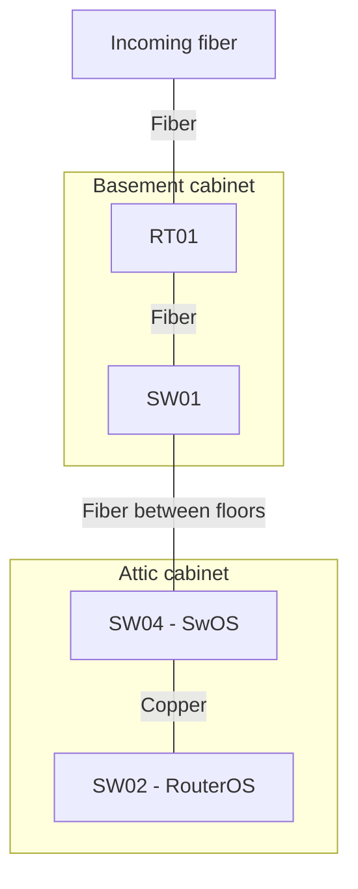
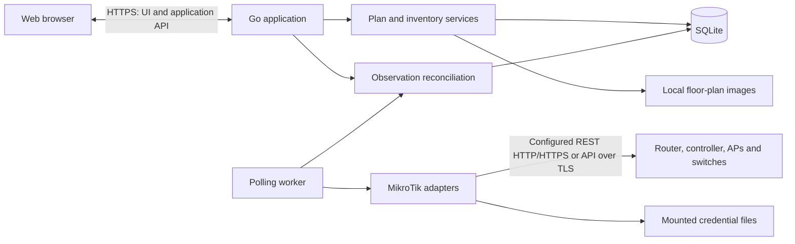

**Yanetviz — home network visualization design**

Draft for review, 7 November 2026. This document proposes the design; it does not implement the application. Hardware models, operating systems, and CAPsMAN usage remain to be confirmed.

**Purpose.** Provide a web view of the home network across three floors: Basement, Entrance floor, and Attic. Place equipment and stationary clients on floor plans, document physical cabling, and show which access point currently serves each Wi-Fi client. Mobile clients remain visible without assigning them a misleading position in the house.

The central design rule is to keep the physical plan separate from live observations. A manually placed printer stays in its room when it changes AP. A documented cable stays in the plan when a switch is unreachable. A phone associated with the attic AP does not automatically belong on the attic floor plan.

**Recommended approach.** Use one Go application that serves a TypeScript web frontend, stores application state in SQLite, and polls configured MikroTik management endpoints. Package the application as one Docker image with persistent local storage. Use YAML only for startup settings and optional export/import of the plan.

The first version targets one household and one application instance. It includes a floor-plan editor, port-to-port cable connections, automatic Wi-Fi association discovery, manual naming and identity matching, and clear data freshness indicators. Network configuration changes, RF coverage prediction, triangulation, traffic inspection, and general network management are outside the first version.

**The web experience.** The main screen has floor tabs, a large plan canvas, a device list, and a detail panel for the selected device or connection. Provide a separate topology view with all three floors visible as groups, so cross-floor wiring is understandable without fitting three architectural drawings onto one screen.

| View | Behavior |
| --- | --- |
| Floor plan | Uploaded background, positioned equipment, stationary clients, and connection overlays; pan, zoom, and filtering |
| Topology | The same devices and connections in a schematic layout grouped by floor, with a separate mobile/unplaced group |
| Devices | Searchable inventory, including unknown clients, mobile clients, and manually documented equipment |
| Integrations | Management endpoints, credential references, detected capabilities, and collection health |

Use separate View and Edit modes to prevent accidental movement. In Edit mode, users can upload a PNG/JPEG plan, drag devices into position, rename them, and connect named ports. A blank background is sufficient until a floor plan is available. Architectural wall drawing and PDF conversion can wait.

Each floor has its own coordinate system. Store positions as normalized x/y coordinates against the original image dimensions, independent of browser zoom. Background replacement preserves positions but offers a preview before saving because a differently cropped drawing may require repositioning. Cable routes can optionally have manual bend points; these describe the documented route, not a measured cable length.

Use solid lines for documented cables, dashed lines for current Wi-Fi associations, and a distinct muted style for stale observations. Include text and icons so status does not depend on color. Show all cables on demand, but show Wi-Fi lines primarily for the selected AP or client to limit clutter. Cross-floor connections end at a labeled portal such as “To Attic / Switch / ether1”; selecting it navigates to the other endpoint.

Mobile clients appear in a “Mobile / location unknown” list, optionally grouped by serving AP. Stationary but unplaced clients appear in an “Unplaced” list. Users can change a client's placement mode between fixed and mobile. A fixed client's wireless line may go to an AP on another floor without moving its marker.

Selecting a device shows its friendly name, interfaces, MAC addresses, observed IPs, placement, documented cables, current wireless associations, last observation time, and collection source. Selecting an AP shows associated clients and available SSID, band, and signal information. Describe radio rates as link rates, not measured internet speed.

**Cabinets and port-to-port cabling.** The confirmed backbone is `RT01 — fiber — SW01 — fiber — SW04 — copper — SW02`. RT01 and SW01 share the basement cabinet; SW04 and SW02 share the attic cabinet. Incoming fiber reaches RT01 in the basement. Exact port names and the incoming termination details remain to be documented; do not invent port assignments from this device-level description.

SW04 is a CSS610-8G-2S+ running SwOS. A user-provided screenshot dated 7 November 2026 documents its Port1 labeled `IV14-SW02-Attic`, linked at 1 Gbps full duplex, and SFP+1 labeled `IV14-SW01-Core`, linked at 10 Gbps full duplex. These identify SW04's backbone endpoints; the corresponding ports on SW02 and SW01 and any intermediate panel terminations remain unknown. Port3 (`Kontor`) reports 10 Mbps full duplex, and Port5 (`LivingRoom`) reports 100 Mbps full duplex. These labels do not yet establish their physical socket or device destinations. The remaining ports report no link; SFP+2 is disabled. Screenshot observations are historical manual records, not live telemetry; detailed settings are saved in the local inventory.

On the floor plan, a cabinet marker groups its devices at one physical location. The topology view expands cabinets into device cards grouped by floor. Expanding a device shows its named ports, and each documented cable attaches to a specific port at both ends. Selecting a cable highlights both endpoints and shows its medium, optional label and length, and observed link status and speed with source timestamps. Keep compact device-level lines when ports are collapsed.

Fiber and copper use distinct solid-line treatments with explicit medium labels; dashed lines remain reserved for Wi-Fi. The inter-floor fiber is one cable with two endpoints, represented by linked portals in individual floor views. Cabinet grouping is organizational, not an additional network hop. A device in a cabinet inherits its floor-plan location, while the topology layout remains independently editable.

Allow incomplete cable drafts with known devices and unresolved ports, clearly labeled as such. These drafts must be resolved before being treated as complete port-to-port documentation. Use manual port records for SwOS equipment so SW04 participates fully in the physical plan even without API collection. Passive devices such as fiber terminations, sockets, and patch panels have ports without requiring management addresses. When documenting passive components, represent each physical cable segment separately.

Both cabinets have patch panels, and wall sockets are distributed around the house. Include these in the initial data model, even if individual terminations are documented incrementally. A patch-panel position or wall jack has separately identifiable front and rear terminals, joined by an explicit internal pass-through. This lets the model distinguish a removable patch lead from permanent building wiring and trace a complete path without treating a passive component as a network switch. Multiple jacks on one wall plate remain separate positions. Record user labels, connector type, copper category or fiber type where known, and unknown terminal mappings without guessing.

For example, a documented path may be `SW01 port → patch lead → basement panel front ↔ panel rear → building cable → wall jack rear ↔ jack front → patch lead → AP port`. The port numbers and socket labels in this example remain unspecified. An internal pass-through is not an additional cable and does not consume a terminal's external cable attachment. Each terminal accepts at most one cable; a panel with many positions does not connect all of them together.

Provide a compact end-to-end connection view by default and a “Trace physical path” action that expands all patch leads, panel positions, building cables, and socket jacks in order. Selecting any segment highlights its full known path across floor and cabinet views. Show an unresolved termination as the end of the known trace. Detect loops and branches and report an ambiguous path rather than inventing a destination. Cross-floor device-level backbone lines describe connectivity; their exact cable segments remain drafts until panel routing is known.

**PoE documentation and visualization.** Store PoE capability, direction, and configured output mode on the supplying port; show power as an overlay on the documented copper path. Keep user-documented settings separate from API observations. A configured auto mode does not establish that power is currently flowing. Record configured mode as `auto`, `forced`, `off`, `unknown`, or `unsupported`, and preserve the original vendor value, including any forced-mode variant. Record PoE standard/type and voltage selection separately: automatic detection is not sufficient evidence of an IEEE PoE standard.

Where supported, collect configured mode and observed output status, voltage, current, and watts with timestamps. Show labels such as “PoE: Auto · Powered · 5.2 W” or “PoE: Forced · Status unknown”; never turn an unavailable measurement into zero. Preserve manual information for SwOS and unsupported sources, and mark old observations stale. MikroTik exposes PoE settings under `/interface/ethernet/poe` and operational values through its monitor command; capability and permissions must be checked on the actual hardware. See [MikroTik PoE-Out documentation](https://help.mikrotik.com/docs/spaces/ROS/pages/19136769/PoE-Out).

Use a lightning icon and direction from the supplying port toward the receiving device, independent of data direction and fiber/copper styling. In an expanded trace, show the overlay through documented copper pass-throughs; label unverified passive-component compatibility as unknown. Fiber carries no PoE, and power tracing stops at an active device unless explicit PoE-out on another port begins a separate power path. Allow an inline injector to be represented as an active component with data-in and powered data-out ports. Do not infer measured power at every downstream segment from the switch-port measurement. This application documents and reads PoE settings; it does not change modes or power-cycle ports.

**Physical plan and observations.** Model three separate kinds of information:

| Information | Authority | Examples |
| --- | --- | --- |
| Physical plan | User | Names, floor placement, stationary/mobile mode, cables, port labels |
| Observations | Management source | Radio registrations, IP addresses, interface status, timestamps |
| Effective view | Application rules | An observed registration mapped to a named client and a physical AP |

Polling never overwrites a user name, moves a marker, or deletes a cable. Cable existence and cable status are different fields: a documented cable can have an observed port-down state or an unknown state. A port reporting link-up does not prove the cable's far endpoint is the documented device.

Document wired connections manually in the first version. Interface status can enrich them where supported. Later, neighbor and bridge-host data can suggest connections for user review. A MAC learned on a switch port may be behind another switch or an AP, so it must not automatically become a direct cable. MikroTik documents these observations in its [bridge host table](https://help.mikrotik.com/docs/spaces/ROS/pages/328068/Bridging%2Band%2BSwitching) and [neighbor discovery](https://help.mikrotik.com/docs/spaces/ROS/pages/24805517/Neighbor%2Bdiscovery) references.

**MikroTik integration.** The router is not necessarily the source of every AP's registrations. Use the CAPsMAN controller where it exposes the relevant clients and AP mapping; otherwise query the APs individually. DHCP leases and ARP information can enrich names and addresses, but do not establish the serving AP or prove current client presence.

Onboarding accepts an explicit management address and a credential reference, tests access, and detects available menus. Save capabilities per source, including registration support and interface inventory support. Report unsupported menus separately from authentication, TLS, and connection failures. Refresh capability discovery after an upgrade or on user request.

| Device/software arrangement | Proposed collection |
| --- | --- |
| Current WiFi package | `/interface/wifi/registration-table`, plus interface/radio inventory to resolve the physical AP |
| Legacy standalone wireless | `/interface/wireless/registration-table` on each AP |
| Legacy CAPsMAN | `/caps-man/registration-table`, joined with controller interface/radio/CAP inventory |
| WiFi CAPsMAN | WiFi registrations and controller radio/CAP inventory, verifying visibility on the installed version |
| RouterOS switch | Interface inventory and supported link status; optional neighbor/host evidence later |
| SwOS switch | Manual equipment and cables initially; optional model-specific SNMP collection later |

MikroTik has separate WiFi and legacy wireless/CAPsMAN menus. The registration tables expose the client MAC and serving interface, which must be resolved to a physical AP rather than treated as a floor location. See the official [WiFi documentation](https://manual.mikrotik.com/docs/wireless/wifi/), [legacy wireless registration documentation](https://help.mikrotik.com/docs/spaces/ROS/pages/8978446/Wireless%2BInterface), and [legacy CAPsMAN documentation](https://manual.mikrotik.com/docs/wireless/abgn/capsman/).

Prefer RouterOS REST over HTTPS for supported installations. It uses username/password HTTP Basic authentication and maps RouterOS menus to `/rest` resources. Normalize its string-valued numbers and booleans into typed application data. See [RouterOS REST API](https://manual.mikrotik.com/docs/developer-guides/rest-api/).

**Confirmed household transport decision, 7 November 2026.** The owner has enabled HTTP REST only on RT01, SW01, SW02, AP01, AP03, and AP04, and explicitly authorizes using it for ongoing read-only collection on this LAN. Configure these sources as `rest-http`; this is an intentional per-source setting, not an automatic fallback from HTTPS. HTTP Basic credentials and responses travel unencrypted. Keep management access restricted to the household network and the application host. Future sources still default to HTTPS, and an HTTPS source must not silently downgrade to HTTP. This decision does not authorize changing device configuration. SW04 remains manual because it runs SwOS.

A read-only `/interface/ethernet` inventory on the same date confirmed 11 physical Ethernet/SFP interfaces on RT01, 28 on SW01, 6 on SW02, and 2 each on AP01, AP03, and AP04. These 51 ports were added to the manual plan with snapshot provenance, retaining all existing documentation. SW04 retains its 10 manually documented ports. This inventory establishes port names, not cable destinations, connector/transceiver details, current link status, or power delivery. Wireless radios and virtual interfaces are separate inventory concerns and are not physical cable terminals.

Keep transport separate from collection logic. If the household inventory requires older RouterOS support, add the native API over TLS as a compatibility transport. Its secure service normally uses port 8729 and needs an appropriately configured certificate for modern TLS clients. Do not silently fall back to unencrypted transport. See [RouterOS API](https://manual.mikrotik.com/docs/developer-guides/api/).

SwOS does not provide the RouterOS API. Its monitoring options depend on the model; for example, the CSS610 documentation describes SNMP support. This does not prevent documenting it in the plan. See [SwOS overview](https://help.mikrotik.com/docs/spaces/SWOS/overview) and [CSS610 monitoring documentation](https://help.mikrotik.com/docs/spaces/SWOS/pages/76939305/CSS610%2Bseries%2BManual).

Map controller-managed interfaces to APs using radio MACs and CAP identity where available. Keep source-native identifiers as observations, not permanent application IDs. Interface renames, re-provisioning, and ambiguous mappings should produce a reconciliation prompt; they must not attach a client to an arbitrary AP. Allow an explicit user mapping when automatic resolution is insufficient.

**Identity and connection state.** Give every application device an internal UUID. A physical device can own several network interfaces, and Ethernet and Wi-Fi can be active simultaneously. Record associations per interface rather than forcing a single device-wide connection.

Use normalized MAC addresses scoped to a network identity domain for client matching. Sources observing the same home LAN share that domain, preventing duplicate clients when both the controller and AP are polled. Do not use IP address, hostname, or a RouterOS row ID as the permanent identity. Randomized/private MACs may create new identities; allow explicit aliasing, merge, and undo. Do not merge clients merely because their hostnames match.

Select one authoritative registration source per managed radio where possible. Keep redundant sources as supporting evidence. If fresh sources disagree, show a conflict with timestamps and source names rather than choosing whichever response arrived last. Client roaming is observed at polling resolution; brief transitions between polls may be missed.

Proposed defaults are a Wi-Fi poll every 15 seconds, inventory refresh every five minutes, a five-second request timeout, and bounded concurrency across sources. Serialize requests within each source, avoid overlapping polls, and use bounded retry backoff with jitter. These intervals are configurable and must be validated against the actual equipment.

Only a successful, complete registration snapshot may establish that a previously seen client is absent. A timeout, partial response, permission error, or unsupported menu is not an empty client list. Retain the last observation and mark it stale after 45 seconds without a fresh successful snapshot. When an authoritative complete snapshot no longer includes the client, show “Not associated” and its last-seen time. This does not claim the device is powered off; it may be asleep or using another network.

Store UTC observation times, successful-snapshot times, and source health separately. After an application restart, restored observations remain stale until refreshed. The UI remains usable during collection failures and always displays when live data was last updated.

**Application structure.** Keep this as a modular monolith with one deployable process:

The browser talks only to the Go application. Polling runs independently of open browser sessions. UI reads use stored state and never wait for a router request. Commit each complete source snapshot and its derived changes transactionally, then notify connected browsers.

Use React with TypeScript and SVG for the proposed frontend. SVG supports device markers, ports, lines, labels, and background images at household scale without a specialized diagramming engine. Bundle the frontend into the Go executable for production. The exact frontend library can change without changing the domain model.

Expose a small same-origin JSON API for floors, assets, devices, placements, ports, cables, integration metadata, and the effective network snapshot. Use Server-Sent Events for snapshot-change notifications; the browser refetches the current snapshot on reconnect. A full snapshot reload is sufficient at this scale and avoids introducing a durable event-delivery system. Use a plan revision to reject conflicting edits from multiple tabs and let the user reload before retrying.

**Local data.** Recommend SQLite as the application source of truth. It supports transactional edits, relationships, and frequently updated observations without operating a database server. Store image files beside the database and reference them by generated asset ID. YAML suits startup configuration and portable plan export, but rewriting it for every observation would complicate concurrency and recovery.

| Entity | Main contents |
| --- | --- |
| Floor / asset | Name, order, background reference, original dimensions |
| Cabinet | Name, floor placement, device membership; independent topology layout |
| Device | UUID, friendly name, roles, model, placement mode; one device may be both router and AP |
| Placement | Device, floor, normalized x/y, optional rotation |
| Interface / radio | Device ownership, stable application ID, labels, MAC aliases, source mappings |
| Passive position / terminal | Panel or wall-plate ownership, position label, front/rear terminals, connector and medium details |
| Internal pass-through | Explicit terminal pair within a passive position; separate from external cables |
| Cable | Two port endpoints, optional label, medium, length, and route points; incomplete drafts retain known device endpoints and unresolved port state |
| Port PoE | Capability/direction, documented mode and standard/type, observed configured mode and raw vendor value, voltage selection, live output status/volts/amps/watts with source timestamps |
| Integration source | Management address, transport, identity domain, credential reference, capabilities |
| Observation | Source, client interface identity, AP/radio mapping, SSID, signal, observed IPs, timestamps |
| Source health | Last attempt, last complete snapshot, error category, freshness |
| Connection event | Association/disassociation/AP change observed by polling; bounded history |

Store current observations and, by default, seven days of connection changes. Do not persist every signal sample. Prune transient observations and events; retain named, placed, and manually documented devices until explicitly removed. Unknown clients can be hidden or forgotten without losing the physical plan.

Use schema migrations and foreign-key constraints. Complete cables require two valid port endpoints; incomplete drafts require two known device endpoints. Reject accidental duplicate links and multiple cables assigned to the same physical connector. Model multiple ports explicitly for equipment with several uplinks. Deleting documented equipment requires showing its dependent placements and cables before applying the edit.

**Credentials and access.** For the initial version, keep integration credentials in read-only mounted secret files. SQLite and YAML contain only a credential reference, and the UI lets the user select a configured reference. This is slightly less convenient than entering router passwords in a form, but avoids introducing a second credential store and encryption-key lifecycle. A later UI-managed credential store would need authenticated encryption with its key supplied outside the database.

Credentials are read only by the backend and never returned by the application API, included in plan exports, or written to logs. Trust a configured local CA or explicitly enrolled certificate and verify server identity; avoid a global “skip TLS verification” option.

Use a dedicated monitoring account on each source. For REST, MikroTik's current example uses a custom group with `read,api,rest-api`; confirm the minimum policies against installed versions. Do not assume the built-in `read` group is narrowly restricted: it includes additional privileges. Restrict management access to the application host. See [REST account guidance](https://manual.mikrotik.com/docs/developer-guides/rest-api/) and [RouterOS user policies](https://help.mikrotik.com/docs/spaces/ROS/pages/8978504/User).

Treat the web application as a private household service. Require one local administrator login, with a hashed application password, secure session cookies, and CSRF protection for edits. Terminate browser HTTPS at an existing reverse proxy or at the application. Restrict integration addresses to configured management destinations and do not expose a general router-command proxy. Validate uploaded images and enforce size limits.

**Docker deployment and recovery.** Deliver one image and an example Docker Compose deployment. Run one non-root application container with a persistent `/data` mount for SQLite and assets, read-only mounts for configuration, credentials, and CA certificates, and an optional existing reverse proxy. No Redis, external database, privileged mode, or host networking is required. The container needs routed outbound access to the management addresses; document VLAN/firewall rules where applicable.

Use a multi-stage build and a minimal runtime image with CA roots. Support Linux amd64 and arm64 if the chosen SQLite build permits it. SQLite should live on a local filesystem and be opened by one application instance. A readiness check covers database access and migrations; an AP outage degrades collection status without taking the whole application out of service. Log source IDs, durations, and error categories with secrets redacted.

Offer a portable plan export for floors, placements, equipment, cables, and image assets, excluding credentials and transient observations. Separately document a full backup: stop the application and copy the entire data directory, or use SQLite's backup mechanism with a coordinated asset copy. Copying only an open main database file is insufficient when WAL is active. Back up credential/configuration files separately. Restore on a clean instance and verify that placements, connections, and assets survive and that integrations can reconnect.

**Acceptance examples.** These are review criteria for later implementation:

1. Place an entrance-floor desktop, connect its Ethernet port to a basement switch port, reload the page, and retain both placement and cable.
2. Pin a stationary Wi-Fi printer to the entrance floor. When it associates with an attic AP, its marker stays fixed and its association changes.
3. Observe a mobile phone roaming between basement and entrance APs. Its serving AP changes within the configured polling interval plus collection time; its physical location remains unknown.
4. Disconnect an AP's management path. Show stale data and a source error without deleting the AP, its clients, or documented cables. A successful empty registration snapshot produces a different result: clients are no longer associated there.
5. Observe a desktop using Ethernet and Wi-Fi at once. Show both interfaces without duplicating the physical device or inventing a direct wired path from bridge learning.
6. Restart and restore the container. Preserve the plan, mark saved live observations stale until refreshed, and keep passwords out of API responses, exports, and logs.
7. Trace a switch-to-AP path through a patch panel and wall jack. Show each cable and internal pass-through, retain the path after reload, and stop clearly at any unresolved terminal.
8. Display a supplying port's automatic or forced PoE mode separately from its current power status. Preserve mode documentation during collection failures, mark measurements stale, and never infer power delivery over fiber or from configuration alone.

**Suggested delivery sequence.** First confirm the hardware/software inventory and inspect sanitized read-only responses from one representative AP or controller. This establishes transport support, registration visibility, and physical AP mapping before committing to an adapter. Next build the manual three-floor plan and cable editor. Then add collection, client matching, freshness, and live updates. Complete the first release with Docker packaging, authentication, export/restore, and the acceptance scenarios above. Add automatic cable suggestions and longer-term history only after the core model works with the household equipment.

**Decisions still open.** The main inputs are device models and operating systems; RouterOS versions and Wi-Fi packages; whether either CAPsMAN generation is used; whether floor images already exist; and the intended Docker host and management-network reachability. Proposed defaults are a single household administrator, uploaded raster plans or blank canvases, manual wired topology, REST over HTTPS where supported, and SQLite. None of these requires implementation before design review.
