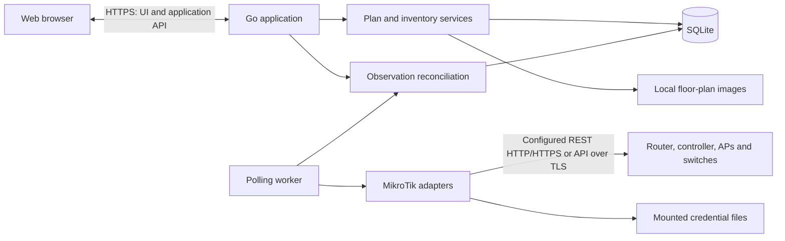

**Yanetviz — home network visualization design**

This document describes the intended application design. See README.md for the currently implemented subset. Hardware inventory, deployment-specific decisions, and collection results belong in private installation data rather than this shared design.

**Purpose.** Provide a web view of a home network across user-defined floors and spaces. Place equipment and stationary clients on floor plans, document physical cabling, and show which access point currently serves each Wi-Fi client. Mobile clients remain visible without assigning them a misleading position in the house.

The central design rule is to keep the physical plan separate from live observations. A manually placed printer stays in its room when it changes AP. A documented cable stays in the plan when a switch is unreachable. A phone associated with the attic AP does not automatically belong on the attic floor plan.

**Recommended approach.** Use one Go application that serves a TypeScript web frontend, stores application state in SQLite, and polls configured MikroTik management endpoints. Package the application as one Docker image with persistent local storage. Use YAML only for startup settings and optional export/import of the plan.

The first version targets one household and one application instance. It includes a floor-plan editor, port-to-port cable connections, automatic Wi-Fi association discovery, manual naming and identity matching, and clear data freshness indicators. Network configuration changes, RF coverage prediction, triangulation, traffic inspection, and general network management are outside the first version.

**The web experience.** The main screen has floor tabs, a large plan canvas, a device list, and a detail panel for the selected device or connection. Provide a separate topology view with floors visible as groups, so cross-floor wiring is understandable without fitting every architectural drawing onto one screen.

| View | Behavior |
| --- | --- |
| Floor plan | Uploaded background, positioned equipment, stationary clients, and connection overlays; pan, zoom, and filtering |
| Topology | The same devices and connections in a schematic layout grouped by floor, with a separate mobile/unplaced group |
| Devices | Searchable inventory, including unknown clients, mobile clients, and manually documented equipment |
| Integrations | Management endpoints, credential references, detected capabilities, and collection health |

Use separate View and Edit modes to prevent accidental movement. In Edit mode, users can upload a PNG/JPEG plan, drag devices into position, rename them, and connect named ports. A blank background is sufficient until a floor plan is available. Architectural wall drawing and PDF conversion can wait.

Each floor has its own coordinate system. Store positions as normalized x/y coordinates against the original image dimensions, independent of browser zoom. Background replacement preserves positions but offers a preview before saving because a differently cropped drawing may require repositioning. Cable routes can optionally have manual bend points; these describe the documented route, not a measured cable length.

Use solid lines for documented cables, dashed lines for current Wi-Fi associations, and a distinct muted style for stale observations. Include text and icons so status does not depend on color. Show all cables on demand, but show Wi-Fi lines primarily for the selected AP or client to limit clutter. Cross-floor connections end at a labeled portal such as “To Attic / Switch / ether1”; selecting it navigates to the other endpoint.

Mobile clients appear in a “Mobile / location unknown” list, optionally grouped by serving AP. Stationary but unplaced clients appear in an “Unplaced” list. Users can change a client's placement mode between fixed and mobile. A fixed client's wireless line may go to an AP on another floor without moving its marker.

Selecting a device shows its friendly name, interfaces, MAC addresses, observed IPs, placement, documented cables, current wireless associations, last observation time, and collection source. Selecting an AP shows associated clients and available SSID, band, and signal information. Describe radio rates as link rates, not measured internet speed.

**Cabinets and port-to-port cabling.** Support equipment distributed across multiple cabinets and floors, with copper and fiber connections between them. Inventory, cabinet membership, cable media, and termination details are installation data. Preserve unknown endpoints rather than inventing port assignments from device-level connectivity. Historical screenshots may support manual documentation, but must be labeled with their source and date rather than presented as live telemetry.

On the floor plan, a cabinet marker groups its devices at one physical location. The topology view expands cabinets into device cards grouped by floor. Expanding a device shows its named ports, and each documented cable attaches to a specific port at both ends. Selecting a cable highlights both endpoints and shows its medium, optional label and length, and observed link status and speed with source timestamps. Keep compact device-level lines when ports are collapsed.

Cabinets have an optional total height in rack units (U). Equipment has an optional height in U and a starting unit within its cabinet. Number units from U1 at the bottom; the starting unit is the lowest occupied unit, so a 2 U device starting at U3 occupies U3–U4. Show a cabinet elevation with higher units at the top and equipment spanning its occupied units. Keep unknown dimensions and unassigned positions explicit rather than assuming a standard cabinet size or 1 U equipment. A known position requires a known equipment height. Validate whole-number values from 1 to 1000, reject overlapping assignments in a cabinet, and reject equipment extending past a known cabinet height. An unknown cabinet height permits partial mounting documentation without claiming capacity has been checked. This initial model treats mounted equipment as occupying the full unit width. Moving equipment to another cabinet or outside a cabinet clears its starting unit while retaining its physical height.

**Cable labeling.** Cabinets and equipment each have an optional short name, falling back to the full name when blank. An endpoint inside a cabinet uses `<cabinet short name or name>:U<equipment starting unit>:P<port number>`; an endpoint outside a cabinet uses `<equipment short name or name>:P<port number>`. Join endpoints in the cable's stored A-to-B order with a hyphen, for example `R01:U10:P05-R01:U12:P05`, `R01:U12:P05-PumpRoom:P01`, or `PumpRoom:P01-ds01:P01`. Pad both rack-unit and port numbers to at least two digits, for example `R01:U03:P05`; retain the U prefix and use the lowest occupied unit for multi-unit equipment. Values above 99 are not truncated. Label text is descriptive and never replaces internal device, port, or cable IDs.

Ports may have an explicit cable-label number from 1 to 9999. Otherwise, infer numbers from simple numeric names, `etherN`, `PortN`, common SFP names (`sfpN`, `SFP+N`, `sfpplusN`, `sfp-sfpplusN`), or a numeric passive position. Copper ports use `P01` while SFP ports use a separate `Psfp01` namespace, so ether1 and sfp1 do not collide. Recognize SFP port type from these names or an explicitly documented SFP/SFP+/SFP28/SFP56 connector. An explicit label number overrides the number while retaining the port-type prefix; custom names still need a documented number. This denotes the SFP cage, not a measurement or inference of the inserted transceiver's medium. Reject ambiguous effective port tokens within a device and ambiguous endpoint text across the plan during generation. Append F/R to passive terminal numbers to distinguish front/rear, for example P01F and P01R. Unknown ports, unknown rack positions, and label collisions produce actionable per-cable preview errors rather than guessed labels. A draft with known endpoint information may be labeled without changing its draft status or claiming its intermediate routing is complete.

Offer auto-label actions for one cable or multiple cables. Preview against the browser's working plan, including unsaved name and mounting changes, without writing it. Keep existing labels unless the user explicitly enables replacement, allow selecting which proposed labels to apply, and retain normal Save, Undo, and revision-conflict behavior. Generated labels remain stored text: later metadata or topology edits do not silently regenerate labels that may already be printed.

Fiber and copper use distinct solid-line treatments with explicit medium labels; dashed lines remain reserved for Wi-Fi. A cable between floors has two endpoints, represented by linked portals in individual floor views. Cabinet grouping is organizational, not an additional network hop. A device in a cabinet inherits its floor-plan location, while the topology layout remains independently editable.

Allow incomplete cable drafts with known devices and unresolved ports, clearly labeled as such. These drafts must be resolved before being treated as complete port-to-port documentation. Use manual port records for equipment without supported collection, including SwOS switches, so it participates fully in the physical plan. Passive devices such as fiber terminations, sockets, and patch panels have ports without requiring management addresses. When documenting passive components, represent each physical cable segment separately.

Support patch panels in cabinets and wall sockets throughout an installation. Include these in the initial data model, even if individual terminations are documented incrementally. A patch-panel position or wall jack has separately identifiable front and rear terminals, joined by an explicit internal pass-through. This lets the model distinguish a removable patch lead from permanent building wiring and trace a complete path without treating a passive component as a network switch. Multiple jacks on one wall plate remain separate positions. Record user labels, connector type, copper category or fiber type where known, and unknown terminal mappings without guessing.

For example, a documented path may be `switch port → patch lead → panel front ↔ panel rear → building cable → wall jack rear ↔ jack front → patch lead → AP port`. The port numbers and socket labels in this example remain unspecified. An internal pass-through is not an additional cable and does not consume a terminal's external cable attachment. Each terminal accepts at most one cable; a panel with many positions does not connect all of them together.

Provide a compact end-to-end connection view by default and a “Trace physical path” action that expands all patch leads, panel positions, building cables, and socket jacks in order. Selecting any segment highlights its full known path across floor and cabinet views. Show an unresolved termination as the end of the known trace. Detect loops and branches and report an ambiguous path rather than inventing a destination. Cross-floor device-level backbone lines describe connectivity; their exact cable segments remain drafts until panel routing is known.

**PoE documentation and visualization.** RouterOS link/PoE polling is now implemented through private `-monitor-config` JSON and explicit default-interface-name-to-port-UUID bindings. It reads allowlisted inventory properties and fixed, one-shot Ethernet/PoE monitor commands, never configuration mutations or power-cycle commands. Monitoring sources can be configured independently from CAPsMAN, while per-endpoint gates serialize requests shared by both collectors. Each source stores independent link and PoE snapshots in the schema-5 observation table; per-channel retry backoff prevents PoE failures from throttling healthy link polls. Unavailable menus/commands are distinct from failed collection and are rechecked every five minutes. Missing interfaces preserve history with current state unknown. Source startup and expired data remain stale until refreshed.

Port and cable details display observed status/rate/duplex, vendor PoE mode/status and nullable V/mA/W measurements alongside the separate manual fields. Supplying-port status propagates through the documented copper/passive path to downstream cable, terminal and device details, including off, waiting, fault and stale conditions. Each derived status identifies its upstream supplying port and timestamp. It is traced evidence, not an independent receiving-port measurement; source voltage/current/watts remain explicitly labeled at the source. A passive pass-through carries status to its opposite terminal even when the next cable is not yet documented. Fiber and unknown media stop propagation. Active devices receive status but do not bridge it between their ports; any explicit observed PoE-out starts a separate path. Fresh reported power adds direction markers along documented copper/passive paths, stopping at fiber, active devices or unresolved mappings. Passive compatibility remains unverified and power is measured only at the supplying port. The browser receives combined Wi-Fi and port snapshots through a single authenticated SSE stream without touching pending plan edits. SwOS monitoring, PoE-in, transceiver details, automatic import and configuration/binding UI remain future work.

**Device discovery and capability overrides (implemented).** Monitoring sources accept `poe: auto | disabled | unsupported`: automatic API probes, intentional omission of PoE reads, or owner-confirmed absence of PoE-out. The last two policies send no PoE requests and do not affect Ethernet polling or upstream received-power tracing. An unavailable API menu is not evidence of unsupported hardware, and the application does not guess features from model-family names. Configured facts take precedence over historical collection errors.

Read-only hardware/software discovery runs at startup and every five minutes with bounded property lists on `/system/resource` and `/system/routerboard`. Observed hardware model, board name, RouterOS version and architecture are stored as optional source-snapshot metadata and displayed independently of manual names/models. Serial numbers are not collected. Inventory refresh failures retain the last successful values and their timestamps, exposing a separate error without erasing physical documentation or blocking link collection. There is no additional SQL migration. Portable plan exports continue to exclude observed inventory and collection configuration.

**Further PoE design.** Store PoE capability, direction, and configured output mode on the supplying port; show power as an overlay on the documented copper path. Keep user-documented settings separate from API observations. A configured auto mode does not establish that power is currently flowing. Record configured mode as `auto`, `forced`, `off`, `unknown`, or `unsupported`, and preserve the original vendor value, including any forced-mode variant. Record PoE standard/type and voltage selection separately: automatic detection is not sufficient evidence of an IEEE PoE standard.

Where supported, collect configured mode and observed output status, voltage, current, and watts with timestamps. Show labels such as “PoE: Auto · Powered · 5.2 W” or “PoE: Forced · Status unknown”; never turn an unavailable measurement into zero. Preserve manual information for SwOS and unsupported sources, and mark old observations stale. MikroTik exposes PoE settings under `/interface/ethernet/poe` and operational values through its monitor command; capability and permissions must be checked on the actual hardware. See [MikroTik PoE-Out documentation](https://help.mikrotik.com/docs/spaces/ROS/pages/19136769/PoE-Out).

Use a lightning icon and direction from the supplying port toward the receiving device, independent of data direction and fiber/copper styling. In an expanded trace, show the overlay through documented copper pass-throughs; label unverified passive-component compatibility as unknown. Fiber carries no PoE, and power tracing stops at an active device unless explicit PoE-out on another port begins a separate power path. Allow an inline injector to be represented as an active component with data-in and powered data-out ports. Do not infer measured power at every downstream segment from the switch-port measurement. This application documents and reads PoE settings; it does not change modes or power-cycle ports.

**Physical plan and observations.** Model three separate kinds of information:

| Information | Authority | Examples |
| --- | --- | --- |
| Physical plan | User | Names, floor placement, stationary/mobile mode, cables, port labels |
| Observations | Management source | Radio registrations, IP addresses, interface status, timestamps |
| Effective view | Application rules | An observed registration mapped to a named client and a physical AP |

Polling never overwrites a user name, moves a marker, or deletes a cable. Cable existence and cable status are different fields: a documented cable can have an observed port-down state or an unknown state. A port reporting link-up does not prove the cable's far endpoint is the documented device.

Document wired connections manually in the first version. Interface status can enrich them where supported. Later, neighbor and bridge-host data can suggest connections for user review. A MAC learned on a switch port may be behind another switch or an AP, so it must not automatically become a direct cable. MikroTik documents these observations in its [bridge host table](https://help.mikrotik.com/docs/spaces/ROS/pages/328068/Bridging%2Band%2BSwitching) and [neighbor discovery](https://help.mikrotik.com/docs/spaces/ROS/pages/24805517/Neighbor%2Bdiscovery) references.

**MikroTik integration.** The initial collector now supports modern WiFi CAPsMAN registrations through `/interface/wifi/registration-table` on an explicitly configured controller. Source configuration and password-file references are private startup JSON, with explicit radio-MAC-to-device mappings; a configuration UI and legacy collectors remain future work. Each poll refreshes allowlisted interface/radio joins before committing complete registrations, avoiding cached interface names after provisioning. Controller-local radios map to the controller itself, while unmapped remote radios remain unresolved. The read-only API exposes source health and registrations reconciled against the current plan's domain/MAC aliases. It never imports devices or edits the plan. Observation storage uses a separate SQLite schema-4 table and does not change plan revisions or portable plan exports. Authenticated SSE updates the observation view independently of pending plan edits. Source errors retain the last complete snapshot; successful empty snapshots establish non-association, and retained data is stale after 180 seconds or restart until refreshed. Unknown clients are visible for manual reconciliation. This increment uses five-second source timeouts, a configurable 5–60 second poll interval (default 60), a maximum of eight independently serialized sources, and bounded retry backoff with jitter.

**Further integration design.** The router is not necessarily the source of every AP's registrations. Use the CAPsMAN controller where it exposes the relevant clients and AP mapping; otherwise query the APs individually. DHCP leases and ARP information can enrich names and addresses, but do not establish the serving AP or prove current client presence.

Onboarding accepts an explicit management address and a credential reference, tests access, and detects available menus. Save capabilities per source, including registration support and interface inventory support. Report unsupported menus separately from authentication, TLS, and connection failures. Refresh capability discovery after an upgrade or on user request.

| Device/software arrangement | Proposed collection |
| --- | --- |
| Current WiFi package | `/interface/wifi/registration-table`, plus interface/radio inventory to resolve the physical AP |
| Legacy standalone wireless | `/interface/wireless/registration-table` on each AP |
| Legacy CAPsMAN | `/caps-man/registration-table`, joined with controller interface/radio/CAP inventory |
| WiFi CAPsMAN | WiFi registrations and controller radio/CAP inventory, verifying visibility on the installed version |
| RouterOS switch | Interface inventory and supported link status; optional neighbor/host evidence later |
| SwOS switch | Manual equipment and cables initially; optional model-specific SNMP collection later |

MikroTik has separate WiFi and legacy wireless/CAPsMAN menus. The registration tables expose the client MAC and serving interface, which must be resolved to a physical AP rather than treated as a floor location. See the official [WiFi documentation](https://manual.mikrotik.com/docs/wireless/wifi/), [legacy wireless registration documentation](https://help.mikrotik.com/docs/spaces/ROS/pages/8978446/Wireless%2BInterface), and [legacy CAPsMAN documentation](https://manual.mikrotik.com/docs/wireless/abgn/capsman/).

Prefer RouterOS REST over HTTPS for supported installations. It uses username/password HTTP Basic authentication and maps RouterOS menus to `/rest` resources. Normalize its string-valued numbers and booleans into typed application data. See [RouterOS REST API](https://manual.mikrotik.com/docs/developer-guides/rest-api/).

HTTP REST may be configured explicitly per source as `rest-http` for an installation that permits unencrypted management traffic. HTTP Basic credentials and responses then travel unencrypted; record the installation's transport decision in private local configuration or notes. New sources default to HTTPS, and an HTTPS source must never silently downgrade to HTTP. Transport choice does not authorize changing device configuration.

Physical Ethernet/SFP inventory can provide port names and snapshot provenance without establishing cable destinations, connector/transceiver details, current link status, or power delivery. Wireless radios and virtual interfaces are separate inventory concerns and are not physical cable terminals. Retain existing documentation when importing discovered ports.

Keep transport separate from collection logic. If an installation requires older RouterOS support, add the native API over TLS as a compatibility transport. Its secure service normally uses port 8729 and needs an appropriately configured certificate for modern TLS clients. Do not silently fall back to unencrypted transport. See [RouterOS API](https://manual.mikrotik.com/docs/developer-guides/api/).

SwOS does not provide the RouterOS API. Its monitoring options depend on the model; for example, the CSS610 documentation describes SNMP support. This does not prevent documenting it in the plan. See [SwOS overview](https://help.mikrotik.com/docs/spaces/SWOS/overview) and [CSS610 monitoring documentation](https://help.mikrotik.com/docs/spaces/SWOS/pages/76939305/CSS610%2Bseries%2BManual).

Map controller-managed interfaces to APs using radio MACs and CAP identity where available. Keep source-native identifiers as observations, not permanent application IDs. Interface renames, re-provisioning, and ambiguous mappings should produce a reconciliation prompt; they must not attach a client to an arbitrary AP. Allow an explicit user mapping when automatic resolution is insufficient.

**Identity and connection state.** Give every application device an internal UUID. A physical device can own several network interfaces, and Ethernet and Wi-Fi can be active simultaneously. Record associations per interface rather than forcing a single device-wide connection.

Use normalized MAC addresses scoped to a network identity domain for client matching. Sources observing the same home LAN share that domain, preventing duplicate clients when both the controller and AP are polled. Do not use IP address, hostname, or a RouterOS row ID as the permanent identity. Randomized/private MACs may create new identities; allow explicit aliasing, merge, and undo. Do not merge clients merely because their hostnames match.

Store interfaces separately from physical cable terminals. Each interface has an internal UUID, owning device, user-facing name, identity domain, and explicitly documented MAC aliases. One device may have several interfaces; one normalized domain/MAC key may belong to only one interface. Normalize 48-bit unicast MACs to uppercase colon notation and domains to lowercase. Unknown interfaces may be documented without a MAC. User edits to aliases or domains are explicit identity decisions, never inferred from a shared hostname or DHCP client ID.

An interface may optionally reference a physical port belonging to the same device. Leave it unset for wireless interfaces or unknown physical mappings; never infer it from a matching bridge MAC or DHCP data. Multiple logical interfaces may reference the same connector. The port reference is part of the manual plan and is preserved in exports, with backend ownership validation and a nullable database foreign key in schema version 3. Removing an uncabled port explicitly unlinks referencing interfaces after confirmation, retaining their MAC identities and DHCP observations. A dangling or cross-device port reference is rejected.

Persist DHCP evidence separately from the manual plan: interface ID, identity domain, source device ID, DHCP server, observed MAC, original client ID and source field (`client-id` or `active-client-id`), observed IPv4/hostname, lease status, and first/last collection timestamps. Preserve client IDs verbatim as optional opaque values; they support reconciliation but cannot select or merge an interface on their own. Keep distinct source/server/MAC/client-ID evidence records, preserving first-seen times and preventing out-of-order samples from replacing newer observations. A changed client ID creates separate evidence, not a new physical device when the domain/MAC still matches. Empty or failed collection does not erase retained observations or establish absence.

Expose interface identities in device details and make MACs and observed addresses searchable. Show saved DHCP records explicitly as historical snapshots rather than online status or AP associations. Keep manual interface identities in plan exports, while DHCP observations remain in the full database backup and are excluded from portable plan exports. Schema version 2 adds relational interface and DHCP observation tables without reseeding existing devices or changing the plan revision. Plan edits preserve observations for surviving identities; explicitly removing an interface, alias, domain binding, or source removes its dependent evidence. Migrations from old note-based imports retain the original notes and leave ambiguous name/IP matches unresolved.

Select one authoritative registration source per managed radio where possible. Keep redundant sources as supporting evidence. If fresh sources disagree, show a conflict with timestamps and source names rather than choosing whichever response arrived last. Client roaming is observed at polling resolution; brief transitions between polls may be missed.

Proposed defaults are a Wi-Fi poll every 60 seconds, inventory refresh every five minutes, a five-second request timeout, and bounded concurrency across sources. Serialize requests within each source, avoid overlapping polls, and use bounded retry backoff with jitter. These intervals are configurable and must be validated against the actual equipment.

Only a successful, complete registration snapshot may establish that a previously seen client is absent. A timeout, partial response, permission error, or unsupported menu is not an empty client list. Retain the last observation and mark it stale after 180 seconds without a fresh successful snapshot. When an authoritative complete snapshot no longer includes the client, show “Not associated” and its last-seen time. This does not claim the device is powered off; it may be asleep or using another network.

Store UTC observation times, successful-snapshot times, and source health separately. After an application restart, restored observations remain stale until refreshed. The UI remains usable during collection failures and always displays when live data was last updated. Observation-stream renewal (once per minute to recheck authentication) or disconnection does not itself make retained readings stale; connection health is shown separately, and the 180-second age limit still applies.

**Application structure.** Keep this as a modular monolith with one deployable process:

The browser talks only to the Go application. Polling runs independently of open browser sessions. UI reads use stored state and never wait for a router request. Commit each complete source snapshot and its derived changes transactionally, then notify connected browsers.

Use React with TypeScript and SVG for the proposed frontend. SVG supports device markers, ports, lines, labels, and background images at household scale without a specialized diagramming engine. Bundle the frontend into the Go executable for production. The exact frontend library can change without changing the domain model.

Expose a small same-origin JSON API for floors, assets, devices, placements, ports, cables, integration metadata, and the effective network snapshot. Use Server-Sent Events for snapshot-change notifications; the browser refetches the current snapshot on reconnect. A full snapshot reload is sufficient at this scale and avoids introducing a durable event-delivery system. Use a plan revision to reject conflicting edits from multiple tabs and let the user reload before retrying.

**Local data.** Recommend SQLite as the application source of truth. It supports transactional edits, relationships, and frequently updated observations without operating a database server. Store image files beside the database and reference them by generated asset ID. YAML suits startup configuration and portable plan export, but rewriting it for every observation would complicate concurrency and recovery.

| Entity | Main contents |
| --- | --- |
| Floor / asset | Name, display order, optional numeric level, background reference, original dimensions; multiple plans may share a level |
| Cabinet | Name, optional short name and height in U, floor placement, device membership; independent topology layout |
| Device | UUID, friendly name, optional short name, roles, model, placement mode, optional equipment height and starting rack unit; one device may be both router and AP |
| Placement | Device, floor, normalized x/y, optional rotation |
| Interface / radio | Device ownership, stable application ID, name, identity domain, normalized MAC aliases, optional physical port on the same device; source/radio mappings can be added for collection |
| Passive position / terminal | Panel or wall-plate ownership, position label, front/rear terminals, connector and medium details |
| Internal pass-through | Explicit terminal pair within a passive position; separate from external cables |
| Port label metadata | Optional numeric cable-label number; inferred simple numbers and terminal side suffixes are checked for ambiguity during label generation |
| Cable | Two port endpoints, optional label, medium, length, and ordered per-floor route sections; incomplete drafts retain known device endpoints and unresolved port state |
| Cable route section | Cable and floor references, sequence, normalized entry/exit portal positions and bend points, route documentation state; no extra physical endpoints |
| Port PoE | Capability/direction, documented mode and standard/type, observed configured mode and raw vendor value, voltage selection, live output status/volts/amps/watts with source timestamps |
| Integration source | Management address, transport, identity domain, credential reference, capabilities |
| Observation | Source, client interface identity, AP/radio mapping, SSID, signal, observed IPs, timestamps |
| DHCP observation | Interface/domain, source device and server, MAC, opaque client ID and source field, observed IPv4/hostname/status, first/last collection timestamps; separate from plan export |
| Source health | Last attempt, last complete snapshot, error category, freshness |
| Connection event | Association/disassociation/AP change observed by polling; bounded history |

Store current observations and, by default, seven days of connection changes. Do not persist every signal sample. Prune transient observations and events; retain named, placed, and manually documented devices until explicitly removed. Unknown clients can be hidden or forgotten without losing the physical plan.

Use schema migrations and foreign-key constraints. Complete cables require two valid port endpoints; incomplete drafts require two known device endpoints. Reject accidental duplicate links and multiple cables assigned to the same physical connector. Model multiple ports explicitly for equipment with several uplinks. Deleting documented equipment requires showing its dependent placements and cables before applying the edit.

**Credentials and access.** For the initial version, keep integration credentials in read-only mounted secret files. SQLite and YAML contain only a credential reference, and the UI lets the user select a configured reference. This is slightly less convenient than entering router passwords in a form, but avoids introducing a second credential store and encryption-key lifecycle. A later UI-managed credential store would need authenticated encryption with its key supplied outside the database.

Credentials are read only by the backend and never returned by the application API, included in plan exports, or written to logs. Trust a configured local CA or explicitly enrolled certificate and verify server identity; avoid a global “skip TLS verification” option.

Use a dedicated monitoring account on each source. For REST, MikroTik's current example uses a custom group with `read,api,rest-api`; confirm the minimum policies against installed versions. Do not assume the built-in `read` group is narrowly restricted: it includes additional privileges. Restrict management access to the application host. See [REST account guidance](https://manual.mikrotik.com/docs/developer-guides/rest-api/) and [RouterOS user policies](https://help.mikrotik.com/docs/spaces/ROS/pages/8978504/User).

Treat the web application as a private household service. Require one local administrator login, with a hashed application password, secure session cookies, and CSRF protection for edits. Terminate browser HTTPS at an existing reverse proxy or at the application. Restrict integration addresses to configured management destinations and do not expose a general router-command proxy. Validate uploaded images and enforce size limits.

**Docker deployment and recovery.** Deliver one image and an example Docker Compose deployment. Run one non-root application container with a persistent `/data` mount for SQLite and assets, read-only mounts for configuration, credentials, and CA certificates, and an optional existing reverse proxy. No Redis, external database, privileged mode, or host networking is required. The container needs routed outbound access to the management addresses; document VLAN/firewall rules where applicable.

Use a multi-stage build and a minimal runtime image with CA roots. Support Linux amd64 and arm64 if the chosen SQLite build permits it. SQLite should live on a local filesystem and be opened by one application instance. A readiness check covers database access and migrations; an AP outage degrades collection status without taking the whole application out of service. Log source IDs, durations, and error categories with secrets redacted.

Offer a portable plan export for floors, placements, equipment, cables, and image assets, excluding credentials and transient observations. Separately document a full backup: stop the application and copy the entire data directory, or use SQLite's backup mechanism with a coordinated asset copy. Copying only an open main database file is insufficient when WAL is active. Back up credential/configuration files separately. Restore on a clean instance and verify that placements, connections, and assets survive and that integrations can reconnect.

**Acceptance examples.** These are review criteria for later implementation:

1. Place an entrance-floor desktop, connect its Ethernet port to a basement switch port, reload the page, and retain both placement and cable.
2. Pin a stationary Wi-Fi printer to the entrance floor. When it associates with an attic AP, its marker stays fixed and its association changes.
3. Observe a mobile phone roaming between basement and entrance APs. Its serving AP changes within the configured polling interval plus collection time; its physical location remains unknown.
4. Disconnect an AP's management path. Show stale data and a source error without deleting the AP, its clients, or documented cables. A successful empty registration snapshot produces a different result: clients are no longer associated there.
5. Observe a desktop using Ethernet and Wi-Fi at once. Show both interfaces without duplicating the physical device or inventing a direct wired path from bridge learning.
6. Restart and restore the container. Preserve the plan, mark saved live observations stale until refreshed, and keep passwords out of API responses, exports, and logs.
7. Trace a switch-to-AP path through a patch panel and wall jack. Show each cable and internal pass-through, retain the path after reload, and stop clearly at any unresolved terminal.
8. Display a supplying port's automatic or forced PoE mode separately from its current power status. Preserve mode documentation during collection failures, mark measurements stale, and never infer power delivery over fiber or from configuration alone.

**Cable routes across floors (implemented).** The manual editor supports the following route documentation features.

Cables whose endpoint devices belong to the same nonempty cabinet are omitted from every floor plan and have no floor-plan routing controls. Cabinet membership, rather than matching coordinates or floors, determines this rule, including for drafts and unplaced cabinets. Such cables remain available in the cable list, endpoint documentation, physical traces, labeling and observations, including PoE path propagation. Preserve any existing route sections in storage and exports; they become available again if the endpoints no longer share a cabinet. This is a drawing rule and does not alter cable identity, completeness or physical connectivity.

1. **Movable cross-floor cable markers.** In Edit mode, drag the circular portal to the actual cable riser or floor penetration. Store each portal's position per cable and floor, independently of device/cabinet positions and other portals. A click selects without moving; dragging uses the existing movement threshold and must not trigger floor navigation on release. View-mode clicks retain navigation to the corresponding section. Unpositioned portals retain the current automatic placement as a fallback, with an explicit reset to that placement.
2. **Editable cable routing.** Select a cable in Edit mode to add, drag, or remove bend points and reset a section to a straight line. Draw the documented route as a polyline through those points. Equipment endpoints remain anchored to their devices or cabinets; moving a device updates its endpoint without moving unrelated bend points. Store normalized coordinates against each floor's original background, preserving routes across zoom, fit-to-view, reload, export, and restore. Routing geometry documents the path without claiming a measured cable length.
3. **Floor levels and intermediate sections.** Give each floor plan an optional integer level, for example basement −1, entrance 0, and attic 1. Levels express vertical order rather than elevation in metres. Floor names and tab order remain independent, and multiple areas may share a level, such as a garage and entrance floor. Unknown levels stay unset. Use levels to suggest intermediate floors, but require explicit selection where multiple plans share a level; never choose an area arbitrarily or claim an actual route from level numbers alone.

Model these items together as an ordered list of route sections belonging to one physical cable. A section is the cable's drawing on one floor, not a new cable, patch lead, port, or network hop. It must not change cable identity, labels, medium, observations, or the rule that each physical connector accepts only one cable. Preserve the distinction between these drawing sections and the separate physical cable segments used to document patch panels and sockets.

For a basement-to-attic cable routed through the entrance floor, show an endpoint-to-exit-portal section in the basement, an entry-portal-to-exit-portal section on the entrance floor, and an entry-portal-to-endpoint section in the attic. Each section has its own bend points and portal positions. Portal labels identify the next section's floor and retain context about the final endpoint. Navigating through a portal keeps the cable selected. Sections form one ordered continuous path; they do not introduce branches or assign coordinates from another floor's drawing.

Suggested intermediate sections start with route geometry explicitly undocumented. Their confirmation state is separate from whether the cable's physical endpoint documentation is complete and whether an observed port is linked. Adding or changing a floor level must not silently rewrite existing user-documented sections. Route edits use the existing Save, Undo, revision checks, and deletion previews. Existing plans load without levels or route sections, with current straight lines and automatic portals as fallbacks.

Implementation details: optional `Floor.level` and ordered `Cable.sections` fields live in existing JSON entity payloads, without a SQL migration or plan-format version change. Section order runs from A to B; each section references one distinct floor and stores optional entry/exit portal coordinates, bend points and a separate `confirmed` flag. A route visits each floor plan at most once in this increment. Missing geometry uses automatic positions. Backend validation rejects unknown or repeated floors, out-of-range coordinates and more than 500 bends per section. Floor levels range from −1000 to 1000.

Double-clicking a line inserts a bend in its nearest drawn segment. Double-clicking a bend or pressing Delete on a focused bend removes it. Intermediate sections are chosen individually, inserted before B and can be reordered or removed. Level-based hints annotate the chooser without selecting a floor. Moving equipment onto another floor preserves historical section geometry and warns that the route needs an explicit reset; it never silently drops documented intermediate sections. Full-route reset requires confirmation; section geometry resets and all changes remain undoable before saving.

Acceptance examples for this work:

- Move one cable portal to a different floor-plan location, save, and reload. Other cable portals and equipment positions remain unchanged; clicking without dragging does not move it.
- Route a cable around a room with several bend points, then zoom, resize, and move one endpoint. Its normalized route persists, and only the device-anchored endpoint follows the device.
- Assign levels −1, 0, and 1, then document a basement-to-attic cable with a routable entrance-floor section. Move both intermediate portals, navigate between sections, and retain one cable ID, one label, and two physical port endpoints.
- Provide two plans at level 0. Intermediate-floor suggestions require an explicit area choice, while existing confirmed sections survive later level changes.
- Undo route edits, reload after a conflicting save, and export/restore the plan. Route sections, bend points, portal positions, and documentation states remain consistent without losing other network documentation.

**Suggested delivery sequence.** First confirm the hardware/software inventory and inspect sanitized read-only responses from one representative AP or controller. This establishes transport support, registration visibility, and physical AP mapping before committing to an adapter. Next build the manual multi-floor plan and cable editor, including the implemented routing controls above. Then add collection, client matching, freshness, and live updates. Complete the first release with Docker packaging, authentication, export/restore, and the acceptance scenarios above. Add automatic cable suggestions and longer-term history only after the core model works with the installation's equipment.

**Deployment inputs.** Each installation supplies device models and operating systems; RouterOS versions and Wi-Fi packages; whether either CAPsMAN generation is used; whether floor images already exist; and the intended Docker host and management-network reachability. Proposed defaults are a single household administrator, uploaded raster plans or blank canvases, manual wired topology, REST over HTTPS where supported, and SQLite. None of these requires implementation before design review.
